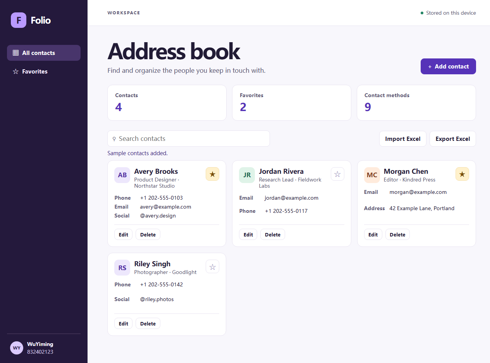
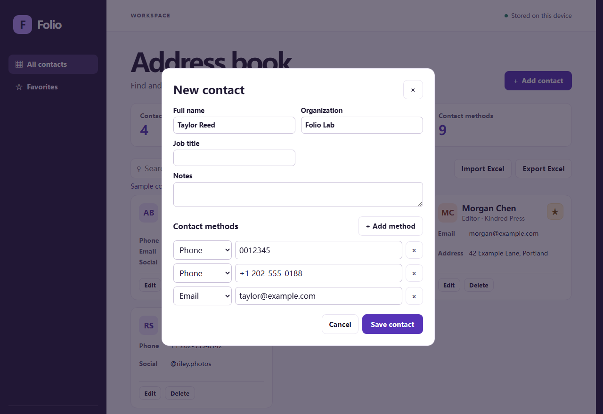
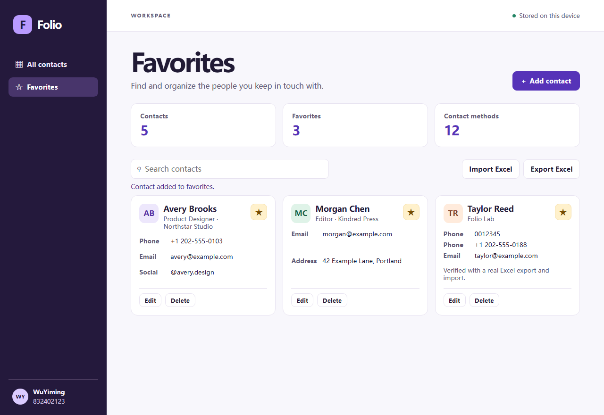
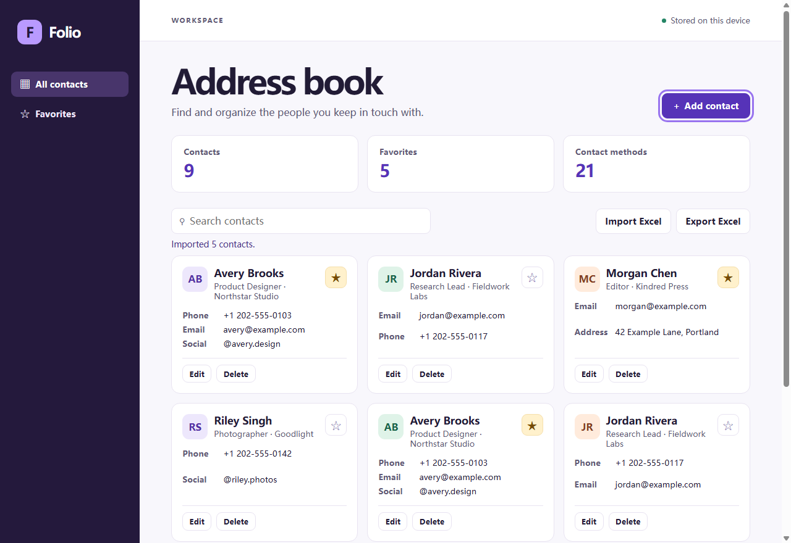
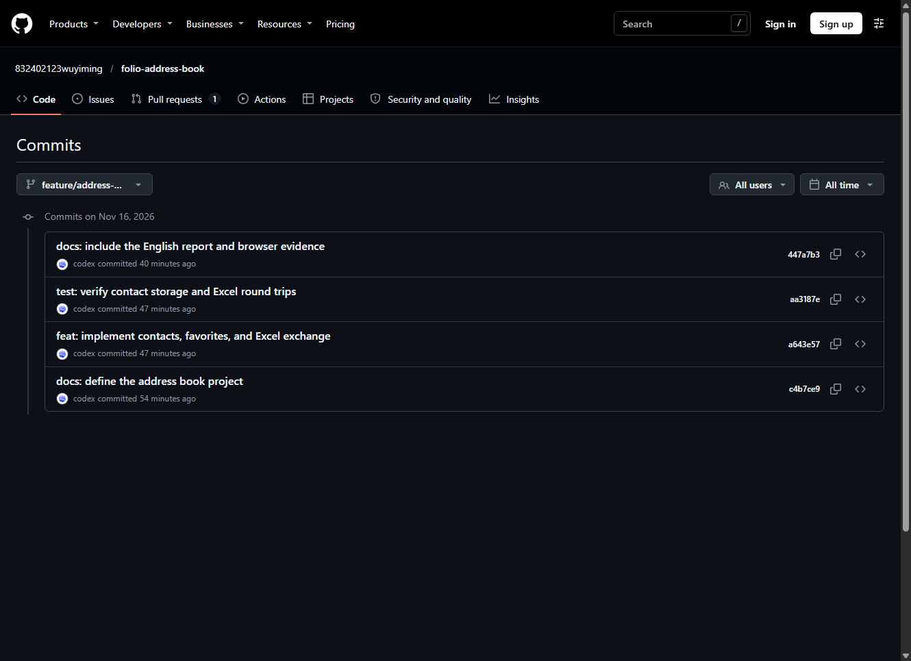

# Folio Address Book

| Item | Content |
| --- | --- |
| Course | [EE308FZ Software Engineering (FZU–MU)](https://bbs.csdn.net/forums/2601_MU_SE_FZU) |
| Student | WuYiming |
| FZU student ID | 832402123 |
| Team name | Folio (individual project) |
| Assignment | [Extreme Programming](https://bbs.csdn.net/topics/620593436) |
| Objectives | Build a usable address book with favorites, multiple contact methods, and Excel import/export. Record the design, Git workflow, and verification. |
| References | [SheetJS standalone library](https://docs.sheetjs.com/docs/getting-started/installation/standalone/) and [Web Storage API](https://developer.mozilla.org/en-US/docs/Web/API/Window/localStorage) |

## Contents

1. [Project and evidence links](#project-and-evidence-links)
2. [Functional design](#functional-design)
3. [Verification and screenshots](#verification-and-screenshots)
4. [Git and project ownership](#git-and-project-ownership)
5. [Personal Software Process](#personal-software-process)
6. [Challenges and rubric check](#challenges-and-rubric-check)

## Project and evidence links

| Item | Location |
| --- | --- |
| GitHub repository | [Folio source](https://github.com/832402123wuyiming/folio-address-book) |
| Pull request | [Implementation PR](https://github.com/832402123wuyiming/folio-address-book/pull/1) |
| GitHub Release | [Folio v1.0.0](https://github.com/832402123wuyiming/folio-address-book/releases/tag/v1.0.0) |
| Code standards | [CODE_STANDARDS.md](CODE_STANDARDS.md) |
| Full program walkthrough | [Download MP4](evidence/folio-walkthrough.mp4) |
| Public deployment | [Folio on GitHub Pages](https://832402123wuyiming.github.io/folio-address-book/) |
| Local execution | See the [README](README.md#run) |

## Functional design

**Interface.** The address book uses a responsive card grid with all contacts and favorites views, summary counts, and a search field. The form supports adding and removing contact methods as needed. Contact values render as text, and the menu and star controls expose their selected state to assistive technologies.

**Favorites.** Each contact stores a Boolean favorite value. Clicking a card’s star saves the new value to browser storage. The Favorites view applies this flag together with the current search query, so users can search inside their favorites.

**Multiple contact methods.** Each contact has a list of `{ type, value }` entries. This allows a contact to hold two phone numbers, one email address, and a social handle without layout or storage changes. The supported categories are Phone, Email, Social, Address, and Other. Editing a contact preserves its favorite state.

**Excel exchange.** A workbook has one row per contact and separate columns for each category. Each populated method column uses a JSON array of strings on export. This preserves repeated values, leading zeros, and punctuation. Import also accepts individual values and newline-separated lists in a cell. It validates all populated rows before appending anything to browser storage.

**Module boundaries.** `app.mjs` manages rendering and interaction. `data.mjs` defines contact records, filtering, and storage. `excel.mjs` maps records to and from the workbook. SheetJS is included locally. Web hosting only needs to serve the files in `dist/`.

## Verification and screenshots

| Check | Observed result |
| --- | --- |
| Create and edit | Created a test contact with two phone numbers and an email address, then saved an edit. |
| Favorites and search | Starred the test contact, filtered to favorites, and found it by phone number. |
| Persistence | Reloaded the page and confirmed that the favorite and the phone numbers remained. |
| Excel exchange | Downloaded an `.xlsx` file, deleted the test contact, and restored it by importing that file. Both phone numbers and the favorite were restored. |
| Failed import | Rejected an invalid `.xlsx` without changing the contact count. |
| Mobile layout | Checked at 390 CSS pixels and confirmed the view fits the screen width. |
| Automated tests | Five Node.js tests passed against the vendored SheetJS library. |

### Address book

### Multiple contact methods

### Favorites

### Excel import

Additional evidence includes the [empty state](evidence/01-empty.png) and the [mobile layout](evidence/06-mobile.png). The [continuous browser walkthrough](evidence/folio-walkthrough.mp4) shows sample data, editing, favorites, search, reload, download, deletion, import, and invalid-file handling.

## Git and project ownership

This is an individual submission. The project was prepared with Codex assistance. No pair-programming sessions, partner contributions, or review approvals are recorded. The branch and its feature, test, and documentation commits provide the local development history.

| Contributor in recorded Git history | Commits in the GitHub screenshot | Areas covered |
| --- | ---: | --- |
| Codex | 4 | Project setup, implementation, tests, and documentation |

The screenshot captures four commits on the feature branch before the publication documentation update. See the [GitHub commit history](https://github.com/832402123wuyiming/folio-address-book/commits/main/) for the current record.

## Personal Software Process

This table records the planned effort. Actual student time has not been supplied.

| PSP activity | Planned time (minutes) | Student actual time (minutes) |
| --- | ---: | --- |
| Planning and requirements | 20 | Unrecorded |
| Design and module boundaries | 25 | Unrecorded |
| Contact management and responsive interface | 55 | Unrecorded |
| Excel import/export | 45 | Unrecorded |
| Testing and demo recording | 40 | Unrecorded |
| Documentation and release preparation | 35 | Unrecorded |
| **Total** | **220** | **Unrecorded** |

## Challenges and rubric check

A single spreadsheet cell must hold several values of a given method type. Using punctuation as a separator can split legitimate addresses and account handles. JSON arrays make the exported format unambiguous, and support for line breaks keeps hand-edited workbooks straightforward.

Import validation runs before the browser state is updated. If a row is missing a name or contains malformed method data, the application reports the row and preserves the existing contacts.

| Rubric item | Submission evidence |
| --- | --- |
| Markdown blog, repository, coding standards | The blog, code standards, repository, pull request, and release are linked above. |
| Implementation explanation and program screenshots | Functional design, screenshots, and MP4 are included. |
| Page style | Desktop and mobile screenshots are included. |
| Favorite contacts | Star controls, Favorites view, and persistence are verified. |
| Multiple methods | Repeated phone numbers and multiple categories were verified. |
| Excel import/export | Workbook round-trip and invalid-file handling were verified. |
| Optional cloud deployment | The static site is publicly hosted on GitHub Pages. |

